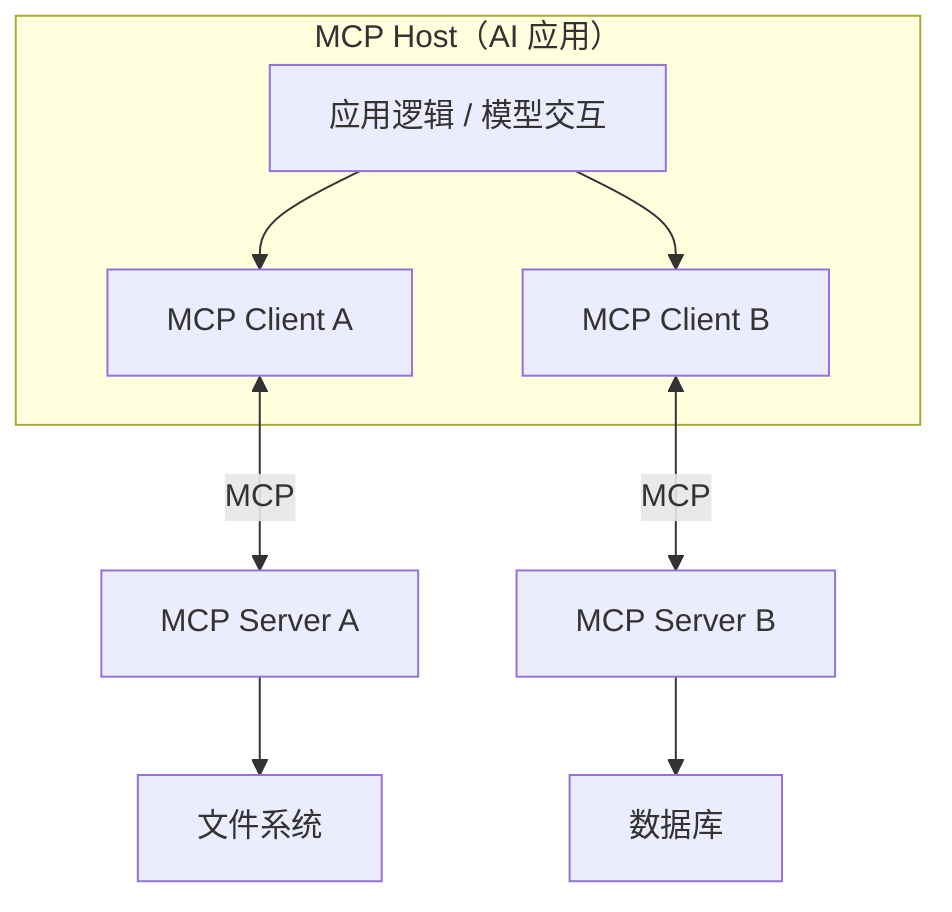
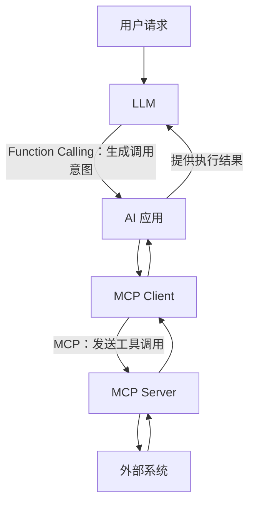
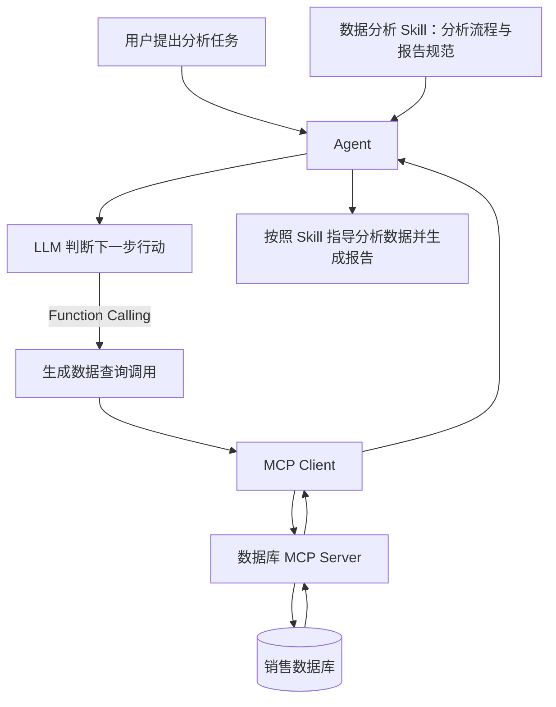

# 理解 MCP、Function Calling 与 Skills：AI Agent 的三种能力机制

> **摘要**：Function Calling、MCP 和 Skills 经常同时出现在 AI Agent 的技术讨论中，但它们不是同一类技术，也不存在简单的替代关系。Function Calling 解决模型如何表达工具调用意图的问题；MCP 解决 AI 应用如何标准化接入外部能力的问题；Skills 解决如何组织和复用完成特定任务所需的知识、流程与资源的问题。

## 1. AI 如何使用外部能力？

大语言模型擅长理解和生成信息，但许多实际任务不可能仅靠生成文本完成。例如，查询数据库、读取本地文件或获取实时信息，都需要访问模型以外的系统。

从高层看，完成这类任务涉及三个不同的问题：

1. **调用意图**：模型如何说明自己希望使用哪个工具，并提供什么参数？
2. **能力接入**：AI 应用如何与不同的外部工具和数据源通信？
3. **任务方法**：面对一类复杂任务，Agent 如何复用既有的知识与工作流程？

Function Calling、MCP 和 Skills 分别为这三个问题提供了不同层面的解决方式。

| 概念 | 核心定位 | 主要解决的问题 |
| --- | --- | --- |
| **Function Calling** | 模型工具调用机制 | 如何生成结构化的工具调用请求？ |
| **MCP** | 外部能力集成协议 | 如何以标准方式连接外部工具、数据源与服务？ |
| **Skills** | 任务知识与工作流程的封装方式 | 如何复用完成特定任务的方法、规范和辅助资源？ |

这三者可以组合使用，但没有哪一种是所有 Agent 都必须具备的组件。

## 2. Function Calling：表达“调用什么”

Function Calling 通常是模型 API 提供的一种工具调用能力。应用预先向模型提供工具名称、用途以及参数结构，模型可以根据用户需求产生结构化的调用请求，而不只是输出自然语言。

例如，应用提供天气查询工具：

```python
def get_weather(city: str) -> str:
    """查询指定城市的天气信息。"""
    ...
```

当用户询问“上海的天气怎么样”时，模型可能返回如下调用意图：

```json
{
  "name": "get_weather",
  "arguments": {
    "city": "上海"
  }
}
```

这里最重要的区别是：生成工具调用请求，不等于执行工具。

在常见的工具调用流程中，模型负责选择工具并生成参数；应用程序或工具执行环境负责真正调用工具，再把执行结果交给模型处理。上述 JSON 只是示意性的调用结构，不代表某个模型厂商的完整 API 报文。

因此，Function Calling 主要建立了**模型与工具调用意图之间的结构化接口**，并不直接规定外部系统应如何接入。

## 3. MCP：标准化“连接什么”

MCP（Model Context Protocol，模型上下文协议）是一种开放协议，旨在标准化 AI 应用与外部工具、数据源等能力之间的交互。

如果每接入一个外部服务都需要开发一套专用适配代码，那么应用与服务会逐渐形成复杂的耦合关系。MCP 的价值在于提供通用的交互方式，使不同提供方能够按统一协议暴露能力，让支持 MCP 的应用以相似的方式发现和使用这些能力。

### 3.1 三个核心角色

MCP 的标准架构通常包含三个角色：

| 角色 | 职责 |
| --- | --- |
| **Host** | 承载 AI 应用，协调用户交互、权限和外部能力的使用 |
| **Client** | 在 Host 内实现 MCP 协议，与相应的 MCP Server 交互 |
| **Server** | 提供工具、资源和提示模板等能力 |



可以简单记忆为：**Host 负责应用协调，Client 负责协议交互，Server 负责能力提供。**

MCP 的协议通信主要发生在 Client 与 Server 之间。Host 是应用架构中的角色，而不是第三个独立的消息传输端点。

### 3.2 MCP 能提供哪些能力？

MCP 最具代表性的服务端能力包括：

- **Tools（工具）**：执行某项操作，例如读取文件、查询数据库或调用外部 API。
- **Resources（资源）**：提供可读取的数据与上下文，例如文档内容或数据库结构信息。
- **Prompts（提示模板）**：提供可复用的提示内容或交互模板。

MCP 负责**定义如何发现和使用这些能力**，但不会自行决定模型应该何时使用它们，也不负责制定完整的任务规划策略。

### 3.3 MCP 与 Function Calling 如何配合？

两者负责的接口不同：



一个常见的流程是：

1. 应用通过 MCP Client 获取 Server 提供的工具信息。
2. 应用将适当的工具定义提供给模型。
3. 模型通过 Function Calling 生成工具调用请求。
4. 应用通过 MCP Client 调用对应的 MCP Server。
5. Server 返回结果，应用再交给模型继续处理。

因此，可以概括为：**Function Calling 关注模型如何表达调用意图，MCP 关注应用如何与外部能力提供者交互。**

也应注意：MCP 不依赖 Function Calling 才能工作。应用可以不经过模型决策，直接使用 MCP 工具或读取资源；反过来，Function Calling 也完全可以调用不使用 MCP 的本地函数或传统 API。

## 4. Skills：封装“如何完成任务”

这里的 Skills 指常见的 **Agent Skills** 机制：将某类任务所需的知识、操作规范、工作流程及辅助材料组织为可复用的能力包。

与 MCP 关注“连接外部能力”不同，Skills 更关注“**如何有效使用已有能力来完成任务**”。

例如，一个用于财务报告分析的 Skill 可以包含：

```text
financial-analysis/
├── SKILL.md
├── scripts/
├── references/
└── assets/
```

其中，`SKILL.md` 通常描述适用场景和执行指导；其他目录可根据需要存放脚本、参考资料及模板。这是一种常见组织方式，并不意味着每个 Skill 都必须包含全部目录。

一个财务分析 Skill 可能指导 Agent：先确认数据口径，再计算关键指标，检查异常值，最后按照统一结构生成报告。这样的指导可以帮助 Agent 稳定地执行一类任务，而不必每次从零组织方法。

某些 Skill 机制还支持**渐进式加载**：先让 Agent 看到名称和简短描述，在任务相关时再加载详细说明和材料，以减少不必要的上下文占用。

需要强调两点：

- Skill **不等于工具**。它可以只包含流程、方法或专业知识，也可以引用工具与脚本。
- Skill **不依赖 MCP**。它可以指导 Agent 使用 MCP 工具、本地函数或其他已有能力，也可以完全不调用工具。

## 5. 三者组合：一个数据分析任务

假设用户提出需求：

> 分析公司最近一个季度的销售数据，并生成一份报告。

一种可行的系统组织方式是：



此时三者的分工非常清晰：

| 技术 | 在任务中的作用 |
| --- | --- |
| **Skills** | 提供分析步骤、统计口径与报告规范 |
| **Function Calling** | 帮助模型选择查询工具并形成调用参数 |
| **MCP** | 标准化应用与数据库服务的交互 |

这只是常见的协作方式之一，不是协议规定的唯一执行顺序。

## 6. 三个常见误区

**误区一：有了 MCP，就不需要 Function Calling。**

不成立。MCP 不负责替模型生成工具调用决策；Function Calling 也不负责定义外部服务的标准接入协议。它们解决不同问题，可以相互补充。

**误区二：Skills 可以调用工具，所以能够完全替代 MCP。**

不成立。Skills 主要组织知识、方法和流程；MCP 主要提供能力发现与交互标准。Skills 可以指导 Agent 使用 MCP，但两者不存在必然的依赖或替代关系。

**误区三：所有 Agent 都必须同时使用这三种机制。**

不成立。一个简单 Agent 可以仅使用模型与本地代码；一个复杂应用也可能使用 MCP 和 Skills，却不把所有操作交给模型通过 Function Calling 决定。具体组合取决于任务需求与系统设计。

## 7. 总结

从高层架构观察，Function Calling、MCP 和 Skills 可以分别理解为三个不同层面的机制：

| 层面 | 技术 | 关键价值 |
| --- | --- | --- |
| **调用表达** | Function Calling | 让模型以结构化方式提出工具调用请求 |
| **能力连接** | MCP | 让 AI 应用标准化接入外部工具和数据源 |
| **方法复用** | Skills | 让 Agent 复用特定任务的知识、规范和工作流程 |

用一句话概括：

> **Function Calling 让模型表达“调用什么”，MCP 让应用知道“如何连接”，Skills 则帮助 Agent 理解“如何完成任务”。**

它们共同拓展了 AI 应用的能力，但并不是构成 Agent 的必要条件。真正重要的是先明确系统需要解决的问题，再选择合适的机制，而不是为使用某一种技术而引入它。

---

### 参考资料

- [Model Context Protocol 官方网站](https://modelcontextprotocol.io/)
- [MCP Specification](https://modelcontextprotocol.io/specification/)
- [OpenAI — Function Calling](https://platform.openai.com/docs/guides/function-calling)
- [Agent Skills 规范](https://agentskills.io/specification)
