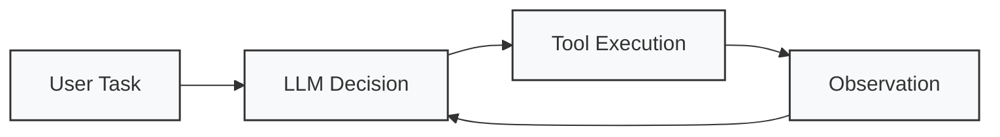
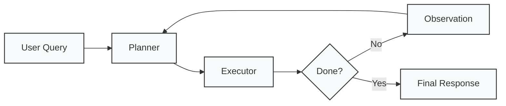
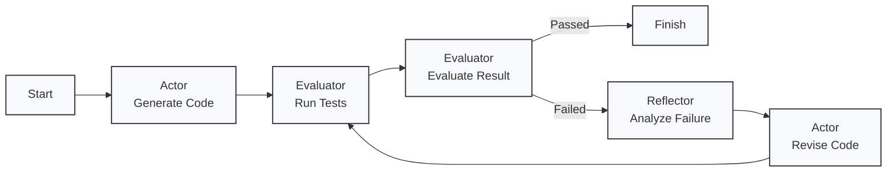

# 为什么需要不同的 Agent 决策范式？

本文我们主要讨论 Agent 如何组织任务、制定计划和修正决策。这是 Agent 开发中非常重要的一类问题。

## 一、为什么需要不同的 Agent 决策范式？

我们可以先考虑三个任务：

1. 任务 A：查询上海今天的天气，并给出出行建议。
2. 任务 B：阅读一个 GitHub 仓库，分析代码架构，并生成一份技术报告。
3. 任务 C：修复一个项目中的 Bug，运行测试，分析失败原因，修改代码，直到测试通过。

这三个任务的复杂度不同。

对于任务 A，我们通常只需要使用简单的 ReAct Agent 就能够完成。但是任务 B 和任务 C 就比较复杂，这就引出了一个核心问题：

> 是否应该让 LLM 在每一次行动之后，都重新决定下一步做什么？

答案是不一定，ReAct 是一种有效的决策范式，但并不是所有任务都适合使用纯 ReAct。

---

## 二、ReAct：逐步决策

我们可以先回顾一下 ReAct 的核心思想，是让模型根据当前任务与观察结果，决定下一步行动。可以抽象为：
$$
a_t = \pi_{\theta}(c_t)
$$
其中：

- $a_t$：当前时刻的行动。
- $\pi_\theta$：LLM 所表示的决策策略。
- $c_t$：当前提供给模型的上下文。

执行行动后，环境产生新的观察：
$$
o_{t+1} = E(a_t)
$$
Runtime 再根据执行结果更新上下文：
$$
c_{t+1} = U(c_t,a_t,o_{t+1})
$$
这里的 \(U\) 表示上下文更新过程，实际实现可能包含历史消息追加、截断、压缩或检索。

于是形成循环：


ReAct 最大的优势是灵活性，模型不需要提前知道完整的执行路径，而是根据当前环境动态决定下一步操作。ReAct 最大的问题不在于不能处理复杂任务，而在于每一步局部决策，不一定能够保证整个任务具有良好的全局规划。

例如，让 Agent 分析一个大型代码仓库。

如果完全依赖局部决策，模型可能出现：

1. 重复读取已经分析过的文件。
2. 忽略重要模块。
3. 在无关细节上消耗过多步骤。
4. 缺少明确的任务完成标准。
5. 随着上下文增长，逐渐偏离原始目标。

需要强调，这些并不是 ReAct 必然出现的问题，而是缺少有效状态管理、计划约束和进度跟踪时容易出现的风险。因此，我们引入 Planning。

---

## 三、Plan-and-Execute：规划与执行分离

Plan-and-Execute 的核心思想是：

> 在执行任务之前，先形成一个相对明确的任务计划，然后按照计划逐步执行。

它通常包含两个逻辑组件。

- Planner：负责理解用户目标、分解任务和生成执行计划。
- Executor：负责执行计划中的具体步骤，并返回执行结果。

典型的框架如下：


这里有一个需要注意的地方：Plan-and-Execute 并不要求 Planner 和 Executor 必须是两个独立的 LLM。

它们可以是：

- 同一个模型的两种调用模式。
- 两个不同的模型。
- 一个 LLM Planner 和一个确定性执行器。
- 一个 Planner 加上多个 ReAct Executor。

这取决于具体系统的架构。

---

## 四、Reflection：基于反馈的自我修正

接下来讨论 Reflection。Reflection 的核心不是提前制定计划，而是利用执行结果或评估反馈，修正已有的输出、计划或行动策略。

例如 Coding Agent：



这里存在三个逻辑环节：

1. Actor：负责执行任务，例如生成代码、修改文件。
2. Evaluator：负责评价结果，例如运行测试、检查约束。
3. Reflector：负责根据评价结果分析失败原因，提出修正建议。

不过，实际系统不一定需要三个独立模型。Evaluator 甚至可以完全由确定性程序实现。

Reflection 不等于模型自己评价自己就一定能够改进。如果没有可靠的外部反馈，模型可能反复生成看似合理、但实际上没有改进的修改方案。Reflection 的有效性，很大程度上取决于反馈信号的质量。

---

## 五、Workflow：确定性编排

前面讨论的 ReAct、Plan-and-Execute 和 Reflection，都包含不同程度的模型自主决策。但并不是所有任务都需要模型决定执行流程。

例如：

> 每天读取指定数据源，生成日报并发送给用户。

如果执行步骤稳定，那么完全可以采用固定 Workflow。

在这种架构中：

- 流程由程序预先定义。
- 模型负责部分节点中的智能处理。
- Runtime 负责执行控制。
- 不需要模型每一步重新规划整个任务。

这通常能够提高执行过程的可预测性，也更容易测试和审计。但如果任务存在大量不可预测的环境变化，固定 Workflow 的灵活性就会受到限制。

---

## 六、四种范式的核心区别

| 维度       | ReAct    | Plan-and-Execute | Reflection   | Workflow       |
| ---------- | -------- | ---------------- | ------------ | -------------- |
| 核心思想   | 逐步决策 | 先规划再执行     | 根据反馈修正 | 预定义执行流程 |
| 自主性     | 高       | 中至高           | 取决于 Actor | 低至中         |
| 全局规划   | 通常较弱 | 较强             | 非主要目标   | 预先确定       |
| 环境适应性 | 强       | 取决于重规划     | 强调反馈修正 | 取决于分支设计 |
| 可预测性   | 相对较低 | 中等             | 取决于实现   | 通常较高       |
| 典型应用   | -        | Research Agent   | Coding Agent | 自动化流水线   |

这四种范式并不是互斥的。

例如，一个 Coding Agent 可以整个执行流程可以由 Workflow 控制，局部步骤由 ReAct Agent 完成，测试失败后触发 Reflection，必要时重新规划。这是一种组合式架构。真正重要的不是选择某个流行范式，而是根据任务特征设计合适的控制结构。

---

## 七、考虑一道系统设计题

假设现在需要开发一个 Coding Agent。

用户输入：

> 请阅读当前 Python 项目，定位导致测试失败的问题，修改代码并运行测试，直到问题解决。

系统提供以下工具：

```python
list_files(path: str)
read_file(path: str)
edit_file(path: str, content: str)
run_command(command: str)
```

需要设计 Agent 的整体执行架构。怎么做？范式选择？组件职责？失败恢复？这些都是需要考虑的问题。

采用**Workflow + Reflection + 局部 ReAct**组合架构：

1. Workflow 固定顶层阶段：加载项目 → 探索代码 → 循环调试 → 完成输出；
2. 代码探索阶段使用 ReAct 调用文件工具浏览仓库；
3. 测试失败分支启用 Reflection 循环（Actor 修改代码，Evaluator 执行`run_command`跑测试，Reflector 分析报错日志）；
4. 若多次失败，可触发 Plan-and-Execute 重新制定排查计划。

**组件职责**

1. **Actor**：调用`read_file`/`edit_file`读写修改源码；
2. **Evaluator**：调用`run_command`执行单元测试，判断测试是否通过（**确定性程序**，无需 LLM）；
3. **Reflector**：读取测试日志，定位报错根因，给出代码修改思路；
4. **Controller（Workflow）**：控制状态流转，最大重试次数限制，防止死循环。

**失败恢复策略**

- 设置最大迭代轮次，避免无限修改；
- 保存代码快照，失败可回滚；
- 日志压缩，防止上下文无限膨胀；
- 连续多次失败后，触发全局重规划，换排查思路。