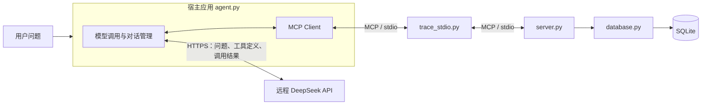
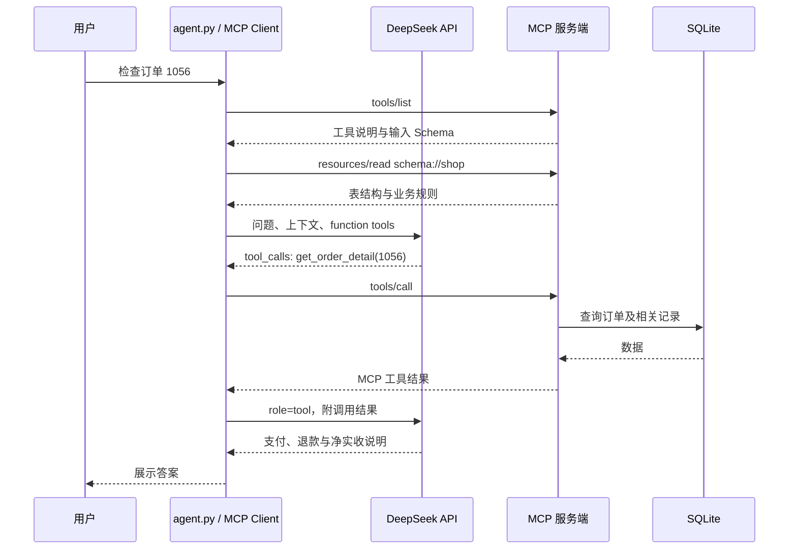

# 从一次数据库查询理解 MCP：协议、进程通信与模型工具调用

> 本文通过一个可运行的 Python 项目，解释 AI 应用如何发现外部能力、调用工具、读取上下文，以及把执行结果交回模型。示例代码来自 [mcp-sqlite](https://github.com/haonox/mcp-sqlite)，读者需要了解基本的 Python 函数、JSON 和 SQL。
>

## 一、从一个具体问题开始

假设我向一个数据库助手提问：

> 检查订单 1056：买了什么，支付失败过吗，退款多少，为什么净实收比订单金额少？

要回答这个问题，系统需要读取客户、订单明细、支付尝试和退款记录。模型可以理解问题、选择查询方法、组织回答，但数据库连接和 SQL 执行需要应用提供。

为了看清这条链路，我做了一个小型电商案例：

- 数据存储在本地 SQLite 中，共 10 张表、702 行模拟数据。
- 服务端通过 MCP 暴露数据库工具、表结构资源和分析提示模板。
- 客户端接入真实 DeepSeek API，让模型选择工具与构造参数。
- 在客户端与服务端之间插入一个转发程序，记录实际传输的 JSON-RPC 消息。

订单 1056 的数据如下，后面会沿着它跟踪一次完整调用：

| 项目     | 数据                                                  |
| -------- | ----------------------------------------------------- |
| 订单金额 | 375.00 元                                             |
| 商品明细 | 收纳盒 2 件，共 78.00 元；无线鼠标 3 件，共 297.00 元 |
| 支付尝试 | 一次失败、一次成功，尝试金额均为 375.00 元            |
| 成功退款 | 两笔，每笔 19.50 元，共 39.00 元                      |
| 净实收   | 375.00 − 39.00 = 336.00 元                            |

这个问题既包含接口调用，也包含业务判断：失败支付不能重复计入收入，同一明细的两次退款需要累计，多表关联还可能造成重复统计。它适合同时检验通信是否正确、数据解释是否准确。

## 二、MCP 在整个系统中负责什么

MCP 的全称是 Model Context Protocol，中文通常译为模型上下文协议。它为 AI 应用与外部系统交换能力描述、上下文和调用结果提供统一的协议接口。[官方架构说明](https://modelcontextprotocol.io/specification/2026-07-28/architecture)

如果数据库、代码仓库、文档系统都遵循同一套发现与调用约定，支持 MCP 的应用就可以复用这些接口。这减少了连接层的重复适配；具体数据结构、统计口径和业务权限仍由各个系统实现。

### 2.1 Host、Client、Server 是三种职责

| 角色           | 职责                                     | 本项目中的对应实现                    |
| -------------- | ---------------------------------------- | ------------------------------------- |
| Host，宿主应用 | 管理模型、上下文、调用循环与能力使用方式 | `agent.py`                            |
| Client，客户端 | 与一个 MCP 服务通信，发送请求、接收结果  | `agent.py` 内创建的 SDK `Client` 对象 |
| Server，服务端 | 暴露外部系统的能力，并执行对应操作       | `server.py`                           |

Host 和 Client 在这里运行于同一个 Python 进程。`Client` 是进程里的对象，不会因为创建一个对象就额外产生一个客户端进程。

宿主可以创建多个 Client，分别连接数据库、文件系统等服务。本项目只连接一个数据库 MCP 服务，便于观察每一条请求。[Host 与 Client 的职责](https://modelcontextprotocol.io/specification/2026-07-28/architecture#core-components)

### 2.2 模型 API 和 MCP 是两段通信



调用 DeepSeek 时，应用使用模型服务的 HTTP API。与数据库服务通信时，应用使用 MCP。二者的请求格式、身份凭据和连接生命周期各自独立。

在这个实现中，DeepSeek 收到的是宿主提供的工具定义，返回的是工具调用建议。接着由宿主把建议转换成 MCP 请求。数据库 MCP 服务接收到工具名与参数后执行操作，不需要知道模型来自哪家服务商。

这也是模型服务的 Tool Calling 与 MCP 可以协作的原因：前者描述模型如何提出调用，后者描述应用如何与外部能力提供方通信。[DeepSeek Tool Calls 文档](https://api-docs.deepseek.com/guides/tool_calls/)

## 三、服务端提供的三类能力

本项目在服务端注册了 Tools、Resources、Prompts。它们分别解决执行操作、获取上下文和复用任务指令的问题。

### 3.1 Tools：可以执行的操作

项目提供七个工具：

| 工具                | 用途                                 |
| ------------------- | ------------------------------------ |
| `list_tables`       | 列出数据库表                         |
| `describe_table`    | 查看字段、外键、索引和行数           |
| `query_readonly`    | 执行只读 SQL，支持自由分析           |
| `get_order_detail`  | 获取订单、商品、支付、退款和包裹详情 |
| `get_sales_summary` | 按日期、城市或渠道汇总订单与净实收   |
| `get_low_stock`     | 查询仓库低库存商品                   |
| `explain_query`     | 查看 SQL 执行计划                    |

工具通过名称、说明和输入 Schema 对外描述自己。客户端可以用 `tools/list` 发现工具，用 `tools/call` 执行调用。[MCP Tools 规范](https://modelcontextprotocol.io/specification/2026-07-28/server/tools)

注册一个工具只需要少量代码。下面摘自项目的 [server.py](https://github.com/haonox/mcp-sqlite/blob/2e7781bc3071da8d1e38025dc2c4d5acc176cc9b/server.py)：

```python
@mcp.tool()
def get_order_detail(order_id: int) -> dict[str, Any]:
    """按订单 ID 返回客户、商品明细、支付尝试、退款、包裹与净实收。订单排查优先使用。"""
    try:
        return database.get_order_detail(order_id)
    except ValueError as exc:
        raise ToolError(str(exc)) from exc
```

SDK 从函数名获得工具名称，从文档字符串获得说明，从参数和类型注解生成输入 Schema。工具的描述可以简化为：

```json
{
  "name": "get_order_detail",
  "description": "按订单 ID 返回客户、商品明细、支付尝试、退款、包裹与净实收。订单排查优先使用。",
  "inputSchema": {
    "type": "object",
    "properties": {
      "order_id": {"type": "integer"}
    },
    "required": ["order_id"]
  }
}
```

装饰器在模块加载时注册函数，此时不会查询订单。真正收到工具调用后，SDK 才验证参数并执行函数体。

服务对象与运行入口则负责启动协议处理：

```python
from mcp.server import MCPServer

mcp = MCPServer("SQLite 订单实验室")

# 在这里通过装饰器注册工具、资源和提示模板。

if __name__ == "__main__":
    mcp.run(transport="stdio")
```

`mcp.run()` 开始通过标准输入输出接收与处理消息。请求解析、方法分派和响应编码由 SDK 完成，业务函数专注于数据库操作。

类型检查能发现“缺少 `order_id`”这样的结构问题；订单是否存在、调用者是否有权读取、统计口径是否正确，需要由业务层决定。写在文档字符串里的说明也不会自动成为数据库约束。

### 3.2 Resources：给模型使用的上下文

项目暴露了一个资源 URI：

```text
schema://shop
```

读取它会得到表结构、关联关系、索引、行数和业务规则。宿主在模型调用循环开始前执行：

```python
resource = await client.read_resource("schema://shop")
schema = "\n".join(
    item.text for item in resource.contents if hasattr(item, "text")
)
messages = [
    {"role": "system", "content": SYSTEM + schema},
    {"role": "user", "content": question},
]
```

这里有两个独立动作：先通过 MCP 取得资源，再由宿主把它加入模型上下文。注册资源不会自动把内容注入模型。

资源适合表达“可以读取的上下文”。工具也可以读取数据，所以不能简单用“只读还是写入”区分二者。`get_order_detail` 就是一个只读工具，而 `schema://shop` 是一个有 URI 的上下文资源。[MCP Resources 规范](https://modelcontextprotocol.io/specification/2026-07-28/server/resources)

### 3.3 Prompts：可复用的任务模板

`sales_analysis(day)` 用于生成指定日期的销售分析指令。客户端可以通过 `prompts/get` 取得渲染后的消息。

例如，传入 `day="2026-11-13"`，模板会提示使用销售汇总工具、关注退款口径，并把金额从分转换为元。

获取模板时，其 Python 函数会执行以生成文字；模板中提到的数据库工具不会因此自动执行。把消息放入对话、继续调用模型，仍由宿主安排。[Python SDK 的 Prompts 说明](https://py.sdk.modelcontextprotocol.io/servers/prompts/)

当前项目的 `client.py` 会演示获取这个模板；`agent.py` 的模型循环使用自己构造的系统指令和数据库资源，没有自动调用该 Prompt。这一行为由项目实现决定。

## 四、拆开协议：消息格式、方法与传输

阅读 MCP 代码时，我会把它分成三个层次：

| 层次               | 解决的问题               | 例子                                         |
| ------------------ | ------------------------ | -------------------------------------------- |
| 消息封装           | 如何表达请求、结果与错误 | JSON-RPC 2.0                                 |
| MCP 方法与数据结构 | 可以发现和调用哪些能力   | `tools/list`、`tools/call`、`resources/read` |
| 传输               | 消息通过什么通道到达对方 | stdio、Streamable HTTP                       |

### 4.1 JSON-RPC 的请求与响应

下面这条请求取自项目的真实通信日志，为阅读方便增加了缩进：

```json
{
  "jsonrpc": "2.0",
  "id": 5,
  "method": "tools/call",
  "params": {
    "name": "get_order_detail",
    "arguments": {"order_id": 1056},
    "_meta": {
      "io.modelcontextprotocol/protocolVersion": "2026-07-28",
      "io.modelcontextprotocol/clientInfo": {
        "name": "mcp",
        "version": "0.1.0"
      },
      "io.modelcontextprotocol/clientCapabilities": {}
    }
  }
}
```

`method` 指定协议方法，`params.name` 指定具体工具，`arguments` 是工具参数。`_meta` 由 SDK 填入，用于携带协议版本、客户端能力等信息。

响应使用相同的 `id`。下面只摘录响应中的部分业务字段，完整结果还包含客户、商品、支付、退款、包裹等内容：

```json
{
  "jsonrpc": "2.0",
  "id": 5,
  "result": {
    "resultType": "complete",
    "isError": false,
    "structuredContent": {
      "financials": {
        "paid_cents": 37500,
        "refunded_cents": 3900,
        "net_received_cents": 33600
      }
    }
  }
}
```

这个 `id` 用来关联 MCP 请求与响应。JSON-RPC 还定义了不带 `id`、不要求响应的通知。需要区分的是，JSON-RPC 本身不规定消息必须使用 HTTP，也不决定底层的进程数量。[JSON-RPC 2.0 规范](https://www.jsonrpc.org/specification)

### 4.2 本案例的协议发现流程

项目日志显示，SDK 连接服务端时首先发送 `server/discover`。服务端响应中声明了 `tools`、`resources`、`prompts` 能力，以及支持的协议修订 `2026-07-28`。

一次实际财务分析的请求顺序为：

```text
server/discover
tools/list
resources/read
tools/call → get_sales_summary
tools/call → get_order_detail
```

阅读其他教程时，可能会遇到 `initialize` 和 `notifications/initialized`。在 `2025-11-25` 及更早的协议中，它们用于初始化会话；`2026-07-28` 修订采用按请求携带版本与能力元数据的方式，不要求这个初始化握手。支持两类协议的 SDK 可以探测对端并兼容旧流程。[版本与兼容性说明](https://modelcontextprotocol.io/specification/2026-07-28/basic/versioning)

因此，分析日志时要先确认协议修订。这里连续存在的管道连接，也不能直接等同于协议层会话：传输连接、协议状态和宿主保存的对话历史，是不同层面的状态。

按请求自包含也不意味着系统没有持久数据。订单仍保存在数据库里，宿主仍保存对话记录，客户端也仍需跟踪尚未返回的请求。

### 4.3 stdio 与 Streamable HTTP

本项目使用 stdio：客户端启动本地子进程，通过标准输入输出交换消息。它便于在本机运行数据库适配程序。

部署远程 MCP 服务时，可以使用 Streamable HTTP，让客户端通过 MCP HTTP 端点发送请求。当前修订的响应可以是一个 JSON 对象，也可以是请求范围内的 SSE 流。更换传输后，应用仍然使用工具、资源等 MCP 能力，但进程管理、鉴权与网络连接需要相应设计。[Streamable HTTP 规范](https://modelcontextprotocol.io/specification/2026-07-28/basic/transports/streamable-http)

本文只实现并验证了本地 stdio 链路。

## 五、沿着一次真实调用，走完模型与工具的循环

用户提出订单问题后，宿主需要先把 MCP 能力转换成模型 API 能理解的格式，再执行模型返回的调用。



图中省略了日志转发进程和连接探测，用来突出模型循环。

### 5.1 把 MCP Tool 转成模型的 function tool

宿主先发现工具：

```python
discovered = await client.list_tools()
```

接着进行一层格式转换，核心代码是：

```python
def model_tools(mcp_tools) -> list[dict]:
    return [{
        "type": "function",
        "function": {
            "name": tool.name,
            "description": tool.description or "",
            "parameters": tool.input_schema,
        },
    } for tool in mcp_tools]
```

MCP 的 `inputSchema` 变成了模型 API 的 `parameters`，名称和说明一同传给模型。这里不需要把数据库查询函数的源码发送出去。

模型能否选对工具，依赖这些描述与当前上下文。项目因此同时提供了自由 SQL 工具和业务工具：商品排行适合自由查询，标准净实收统计则可以直接使用口径明确的 `get_sales_summary`。

### 5.2 模型返回调用建议

DeepSeek 可能返回这样的消息。下面缩短了调用标识符，以突出结构：

```json
{
  "role": "assistant",
  "tool_calls": [
    {
      "id": "call_order_1056",
      "type": "function",
      "function": {
        "name": "get_order_detail",
        "arguments": "{\"order_id\": 1056}"
      }
    }
  ]
}
```

`arguments` 在这里是 JSON 字符串。宿主需要解析它，确认工具位于已发现的工具集合中，然后通过 MCP 执行：

```python
arguments = json.loads(function["arguments"])
result = await client.call_tool(name, arguments)
```

到这一步，数据库操作才真正发生。工具失败时，宿主也会把错误返回给模型，让它有机会修正调用。

### 5.3 把结果交回模型

宿主保留模型原来的 assistant 消息，再追加工具消息：

```python
messages.append({
    "role": "tool",
    "tool_call_id": call["id"],
    "content": json.dumps(result, ensure_ascii=False),
})
```

随后把更新后的对话再次发送给 DeepSeek。模型可以继续提出工具调用，也可以给出最终回答。

这里有两套标识符，不能混用：

| 标识符                                 | 属于哪一层 | 关联什么                           |
| -------------------------------------- | ---------- | ---------------------------------- |
| JSON-RPC `id`，例如 `5`                | MCP 通信   | 一条协议请求与响应                 |
| `tool_call_id`，例如 `call_order_1056` | 模型对话   | 一次模型工具调用与返回给模型的结果 |

MCP 请求标识由 SDK 管理，模型调用标识随模型响应返回。宿主在两段通信之间完成对应关系。完整逻辑可以查看项目的 [run_loop 与 execute_tool](https://github.com/haonox/mcp-sqlite/blob/2e7781bc3071da8d1e38025dc2c4d5acc176cc9b/agent.py)。

## 六、stdio 管道中究竟发生了什么

### 6.1 本地运行时的三个进程

本项目为了观察通信，使用下面的启动参数：

```python
server = StdioServerParameters(
    command=sys.executable,
    args=[
        str(ROOT / "trace_stdio.py"),
        str(args.trace.resolve()),
        str(ROOT / "server.py"),
    ],
    cwd=ROOT,
    env={"MCP_DB_PATH": str(args.db.resolve())},
)
```

`StdioServerParameters` 先描述启动方式。进入 `async with Client(server)` 后，SDK 才建立连接并启动相应子进程。[SDK Client 生命周期](https://py.sdk.modelcontextprotocol.io/client/)

运行期间的相关进程是：

```text
agent.py
└── trace_stdio.py
    └── server.py
```

`sys.executable` 保证子进程使用当前 Python 解释器；`cwd` 设置工作目录；`MCP_DB_PATH` 给数据库服务提供文件路径。转发进程启动服务端时会继承这项配置。

SQLite 是嵌入式数据库，由 `server.py` 进程中的数据库代码访问文件，不需要单独启动数据库服务进程。DeepSeek 则运行在远端。

### 6.2 每个方向都有自己的管道

标准输入输出在这里连接到了管道：

```text
客户端 SDK 的发送通道 → trace 的 stdin → server 的 stdin
客户端 SDK 的接收通道 ← trace 的 stdout ← server 的 stdout
```

客户端的普通终端输出仍可用于展示结果；发给子进程的协议消息由 SDK 管理。不能把客户端打印到终端的所有内容都理解为发给服务端的消息。

stdio 的每条 MCP 消息以换行符分隔，服务端从 stdin 读取请求，将响应或相关通知写入 stdout；日志可写入 stderr。[stdio 消息边界](https://modelcontextprotocol.io/specification/2026-07-28/basic/transports/stdio)

管道传输字节流，一次读取可能得到半条消息，也可能得到多条。读取端需要累计数据并识别完整行，才能解析 JSON。文中为了阅读而格式化的多行 JSON，在实际管道中被编码为单行；字符串里的换行则使用 JSON 转义。

两端通过阻塞读取或异步等待接收数据，不需要持续空转检查。SDK 的后台接收任务读到响应后，根据请求 ID 找到正在等待结果的调用。

### 6.3 转发程序为什么使用两个线程

转发进程需要同时处理两个方向：

```text
工作线程：读取自己的 stdin，写入 child.stdin
主线程：  读取 child.stdout，写入自己的 stdout
```

两个读取操作都可能等待数据。把它们放在独立的执行路线中，就不会因为等待一个方向而停止处理另一个方向。

转发的核心代码如下，省略了异常处理和进程清理：

```python
for line in iter(source.readline, b""):
    entry = {
        "time": datetime.now(timezone.utc).isoformat(),
        "direction": direction,
        "message": json.loads(line),
    }
    with lock:
        trace.write(json.dumps(entry, ensure_ascii=False) + "\n")
        trace.flush()
    destination.write(line)
    destination.flush()
```

收到的字节一份用于解析和记录，另一份直接写向接收端。转发的数据保留原始字节；日志经过解析和重新序列化，保留消息内容，但不保证保留原始空格等字节细节。

两个线程共同写一个日志文件，所以使用同一把锁协调写入。它们并不通过这把锁交换业务消息；业务消息的交换发生在进程之间的管道上。

### 6.4 转发进程是观察工具

如果让 SDK 直接启动 `server.py`，工具调用和资源读取仍然能正常工作：

```python
server = StdioServerParameters(
    command=sys.executable,
    args=[str(ROOT / "server.py")],
    cwd=ROOT,
    env={"MCP_DB_PATH": str(args.db.resolve())},
)
```

此时只需要客户端与服务端两个相关进程。

在本项目安装的 SDK 中，默认 stdio 入口没有直接提供记录全部双向原始报文的回调。`logging_callback` 接收服务端日志通知，`message_handler` 也不等于双向流量抓取接口。另一种实现方式是在客户端内包装传输流进行观测；独立转发程序只是更便于展示的一种选择。[SDK 回调说明](https://py.sdk.modelcontextprotocol.io/client/callbacks/)、[传输接口](https://py.sdk.modelcontextprotocol.io/client/transports/)

完整的 [trace_stdio.py](https://github.com/haonox/mcp-sqlite/blob/2e7781bc3071da8d1e38025dc2c4d5acc176cc9b/trace_stdio.py) 还处理输入 EOF、关闭服务端 stdin，以及服务端未退出时的终止与回收。它面向合法的 MCP JSON 行；非法 JSON 的详细诊断和更完善的线程收尾仍可继续改进。

## 七、异步、线程和进程各自解决什么问题

这是阅读项目时最容易混在一起的几个概念。

| 概念           | 本项目中的作用                                               |
| -------------- | ------------------------------------------------------------ |
| 进程           | 隔离客户端、转发程序、服务端的 Python 内存空间               |
| 线程           | 转发程序同时处理两个方向；客户端在线程池中发送阻塞 HTTP 请求 |
| 协程与事件循环 | 等待模型或 MCP 结果时，让其他异步任务继续运行                |

### 7.1 进程之间通过消息传递数据

`agent.py` 中的 `messages` 字典列表，与 `server.py` 中的查询结果对象，位于不同进程的内存中。客户端发送 JSON 字节，服务端解析后得到自己的对象。

它们可以包含相同的数据，但不是同一个 Python 对象。当前程序没有建立进程间共享内存。

共享外部资源则是另一回事。如果同时启动两个助手并使用相同日志路径，日志可能覆盖或混杂。进程隔离本身不会解决共享文件的访问问题。项目提供了 `--log` 和 `--trace`，可以为不同运行指定独立文件。

### 7.2 阻塞 HTTP 请求被放进工作线程

项目使用标准库 `urllib` 调用 DeepSeek，它的网络请求是阻塞式的。因此提供了一个异步包装：

```python
async def complete(self, payload: dict) -> dict:
    return await asyncio.to_thread(self._request, payload)
```

`to_thread` 把 `_request(payload)` 安排在线程池中执行。当前协程等待它完成，事件循环可以继续运行其他任务。工作线程拿到结果后，等待的协程再继续执行。[Python asyncio.to_thread](https://docs.python.org/3.13/library/asyncio-task.html#asyncio.to_thread)

这里传入的是函数 `self._request` 和参数 `payload`，而不是先执行 `self._request(payload)` 再传入返回值。后者会提前在当前线程阻塞。

### 7.3 异步代码也可以按业务依赖顺序执行

当前调用循环的顺序仍然是：

```python
response = await api.complete(payload)
# 解析模型提出的调用
result = await client.call_tool(name, arguments)
# 把结果追加到 messages，下一轮再请求模型
```

模型还没有返回工具名时，应用无法执行对应工具；数据库还没有返回数据时，应用也无法把结果交给模型。

模型一次提出多个工具调用时，本项目使用普通 `for` 循环逐个 `await`，因此工具调用也按顺序执行。将来可以对彼此独立的调用增加并发，但需要明确依赖关系、超时和结果配对。

所以，异步在这里主要改善等待时的调度与响应性，不会自动缩短所有步骤的耗时，也不会让 SQLite 查询本身自动加速。

## 八、通信成功之后，还要回答正确

MCP 可以规范地把参数传到服务端，再把结果带回来。业务含义是否正确，需要在接口设计、数据库实现和宿主逻辑中继续保证。

### 8.1 多表 JOIN 为什么会放大金额

订单 1056 有两个商品明细。如果执行：

```sql
SELECT SUM(o.amount_cents)
FROM orders o
JOIN order_items i ON i.order_id = o.id
WHERE o.id = 1056;
```

结果是 `75000` 分，即 750 元。订单总金额 375 元因为两条明细被累计了两次。

再关联支付尝试、退款和包裹，还会继续增加重复行。即使给订单数加 `COUNT(DISTINCT o.id)`，也不会自动修复已经重复的金额求和。

项目采用两种处理方式：

- `get_order_detail` 在同一只读事务中分别读取商品、支付、退款和包裹，保持各自的列表。
- `get_sales_summary` 先分别按订单聚合成功支付与成功退款，再关联订单与客户进行分组统计。

这也是保留业务工具的价值：把稳定的统计规则放在服务端，减少模型反复编写同一段复杂聚合的机会。自由 SQL 工具则用于没有固定接口的分析任务。[数据库查询实现](https://github.com/haonox/mcp-sqlite/blob/2e7781bc3071da8d1e38025dc2c4d5acc176cc9b/database.py)

### 8.2 数据里没有的事实，不能由金额推断出来

退款表记录退款金额，没有记录退货件数。39 元退款金额恰好等于一件收纳盒的成交价，也不能据此断言“实际退回了一件收纳盒”。

类似地，执行计划出现 `USING INDEX` 只能说明使用了索引；出现 `USING COVERING INDEX` 才明确表示覆盖索引。工具结果和系统指令因此都补充了这些解释边界。

参数的语义也需要验证。例如用户说“上海仓”，模型应该先依据真实数据确认仓库 ID，或读取包含仓库名称的结果，不能只凭整数类型校验就认定 `warehouse_id=1` 一定代表上海仓。

这些例子说明，格式正确和语义正确需要分开验证。成功调用一次工具是证据来源，不等于后续每一句自然语言解释都已得到验证。

### 8.3 统计时间范围要说清楚

对 2026-10-01 至 2026-11-14 的已支付订单，模拟数据的基准结果是：

| 指标         |         结果 |
| ------------ | -----------: |
| 已支付订单数 |           88 |
| 成功支付金额 | 41,330.00 元 |
| 成功退款金额 |    634.50 元 |
| 净实收       | 40,695.50 元 |

这里按下单日期选择订单，收退款累计至观察日 2026-11-14，只有 `succeeded` 状态计入。它描述的是这一批订单截至观察日的收退款情况，不是该日期区间内发生的收退款现金流。

把时间与状态口径放进 Resource 和工具说明，能让模型更容易形成一致解释；关键计算依然由数据库代码实现。

## 九、错误、约束与可观测性

### 9.1 三类错误需要分别处理

| 层次     | 例子                               | 当前处理方式                                 |
| -------- | ---------------------------------- | -------------------------------------------- |
| 模型 API | 鉴权失败、限流、连接超时           | 转为 `DeepSeekError`，结束本次运行并记录原因 |
| MCP 协议 | 无法识别的方法或协议请求问题       | 由 SDK 按协议返回或抛出错误                  |
| 工具执行 | 订单不存在、SQL 不合法、写入被拒绝 | 返回失败的工具结果，供模型修正               |

服务端用 `ToolError` 表达预期的工具失败，客户端关注 `is_error`，并把失败信息作为工具结果放回对话。客户端还检查模型生成的参数是不是合法 JSON、工具名称是否位于发现的工具集合中。

工具调用失败时，协议仍可能正常完成了请求与响应。因此，需要同时检查传输结果和工具结果中的 `isError`。这个项目也没有自动重试模型 HTTP 请求，避免把网络层重试与模型根据业务错误重新调用工具混为一谈。

### 9.2 限制由可执行逻辑落实

数据库工具包含几项具体限制：

- 通过 `mode=ro` 打开数据库，并启用 `query_only`。
- 使用 SQLite authorizer，根据解析后的操作类型拒绝写入、ATTACH、PRAGMA 等操作。
- 查询值通过 `?` 占位符绑定，避免把参数值拼接成 SQL。
- 最多返回 100 行，多读取一行判断是否截断，并返回 `truncated`。
- 使用进度回调，在约一百万条 SQLite 虚拟机指令后中止查询。

宿主默认最多进行 10 轮模型请求，每轮最多生成 2048 个输出 token。

这些边界各有作用范围。参数绑定不能限制模型查询哪些表；行数限制不能限制单行数据大小；虚拟机指令预算也不是严格的时间或内存配额。只读连接限制修改数据，不代表已经实现了按用户隔离的读取权限。

本案例使用本地虚构数据，未实现多用户授权、字段级访问控制或完整 SQL 审计。扩展到其他数据环境时，这些能力需要由应用和服务端继续提供，不能只写进提示词。

### 9.3 两层日志把决策与执行连接起来

项目保留两类日志：

| 日志              | 可以回答的问题                                           |
| ----------------- | -------------------------------------------------------- |
| `agent.jsonl`     | 给模型传了哪些工具？模型返回什么调用？结果如何交回模型？ |
| `agent-mcp.jsonl` | 实际发出了哪个 MCP 方法？参数是什么？服务端返回了什么？  |

核对一次调用时，我会依次检查：

1. 模型返回的工具名称与参数。
2. 对应 `tools/call` 请求中的名称与参数是否一致。
3. MCP 请求与响应的 `id` 是否配对。
4. 工具结果是否成功、是否截断，以及业务结果是否符合独立基准。
5. 最终回答中的金额、状态和推断是否有数据支持。

日志记录 JSON 请求体，不记录 HTTP Authorization 请求头，并对已知密钥进行替换。模型需要的表结构和查询结果会通过模型 API 发给 DeepSeek；凭据配置留在本地，二者的用途不同。

一次完整检查之后，可以区分“模型选错工具”“宿主转错参数”“SQL 聚合错误”和“模型解释超出数据”等问题，而不只是看到最后一句回答。

## 十、复现这个案例

### 10.1 先观察不依赖模型的 MCP 调用

需要 Python 3.11+ 和 uv。克隆项目后初始化数据并运行预设客户端：

```bash
git clone https://github.com/haonox/mcp-sqlite.git
cd mcp-sqlite
uv sync --locked
uv run python database.py
uv run python client.py --check-errors
```

这条路径不需要模型 API 密钥，会演示工具发现、资源读取、提示模板，以及查询与错误响应。它帮助读者先单独理解 MCP 通信。

### 10.2 再接入 DeepSeek

首次使用时复制配置模板：

```bash
cp .env.example .env
```

编辑 `.env`，填入自己的凭据：

```dotenv
DEEPSEEK_API_KEY=replace-with-your-key
DEEPSEEK_MODEL=deepseek-flash
```

然后提出自然语言问题：

```bash
uv run python agent.py '检查订单 1056，解释支付重试、退款和净实收。'
uv run python agent.py '统计 2026-10-01 至 2026-11-14 按城市的成功支付、成功退款和净实收。'
```

模型可能选择不同的调用次序或表述方式，但计算结果应与模拟数据一致。数据库、日志和虚拟环境均在本地生成，仓库提供完整表结构与数据生成代码。

### 10.3 对照真实验证与回归测试

这个项目已经使用真实 DeepSeek API 验证了两类任务：

| 任务                               | 实际选用的工具                                     |
| ---------------------------------- | -------------------------------------------------- |
| 按城市汇总财务、排查订单 1056      | `get_sales_summary`、`get_order_detail`            |
| 查询低库存、商品销售排行与执行计划 | `get_low_stock`、`query_readonly`、`explain_query` |

记录中的模型工具调用与 MCP 请求已逐项核对。基准金额、商品排行与索引计划也与本地数据进行了独立核对；这能验证已执行的案例，不保证未来每次模型输出都正确。

项目另有 20 项自动测试，覆盖数据一致性、只读限制、聚合口径、工具错误恢复、多工具结果配对，以及真实子进程之间的 MCP 调用：

```bash
uv run python -m unittest -v
```

自动测试中的模型响应由测试桩提供，不消耗模型 API 额度。真实 MCP 子进程测试则使用临时数据库，验证进程与协议链路。

如果要继续深入，可以做三个小实验：在日志里对照一次 `tools/list` 和实际工具注册；让模型请求一个不存在的订单，观察错误如何返回；比较选择少量列与选择整行时的执行计划，观察普通索引与覆盖索引的区别。

完成这些实验后，一次自然语言数据库查询就可以拆成一组可观察的工程动作：宿主准备上下文，模型提出调用，Client 编码消息，Server 执行业务，宿主再把结果交给模型。MCP 为其中的能力发现与调用建立统一约定，而应用仍然负责数据边界、业务语义与结果验证。

## 延伸阅读

- [mcp-sqlite 项目仓库](https://github.com/haonox/mcp-sqlite)
- [MCP 架构](https://modelcontextprotocol.io/specification/2026-07-28/architecture)
- [MCP 版本与兼容性](https://modelcontextprotocol.io/specification/2026-07-28/basic/versioning)
- [stdio 传输规范](https://modelcontextprotocol.io/specification/2026-07-28/basic/transports/stdio)
- [官方 Python SDK](https://github.com/modelcontextprotocol/python-sdk)
- [DeepSeek Tool Calls](https://api-docs.deepseek.com/guides/tool_calls/)